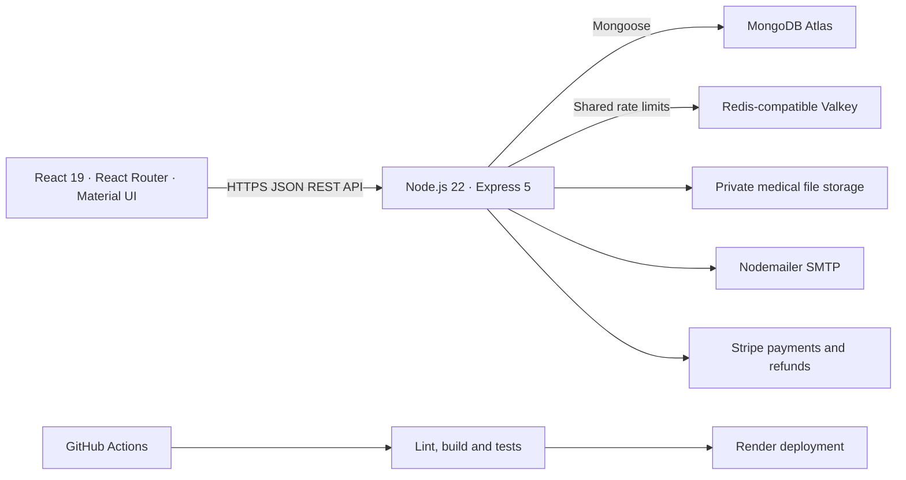

# Hospiq project guide

Hospiq is a hospital workflow web application. It connects public care discovery and patient self-service with the outpatient queue, clinical documentation, laboratory follow-up, and pharmacy collection.

[Live demo](https://hospiq-demo.onrender.com) · [Source repository](https://github.com/adarshprakasan/Hospiq) · [Documentation index](README.md)

## What each role can do

| Role | Workflows |
| --- | --- |
| Visitor | Search hospitals and doctors, browse departments and availability, and carry the selected doctor through sign-in to booking. |
| Patient | Book, reschedule, or cancel queue visits within the allowed states, present a visit QR, track queue progress, review finalized notes and labs, manage family access, and track prescriptions, payments, and receipts. |
| Hospital staff | Register walk-ins, issue one-use visit claim codes, check patients in, call them from the queue, and manage hospital-scoped visits. |
| Doctor | View the assigned queue, start consultations, record vitals, save private drafts, finalize visits, append corrections, create lab orders, and review results. Historical patient data is subject to access checks. |
| Pharmacist | Review prescription orders, confirm available quantities, record counter payment or use configured Stripe checkout, issue eligible full refunds, record collection, and adjust inventory batches. |
| Hospital administrator | Register a facility for platform approval, then manage the facility's staff, doctors, departments, schedules, and operational metrics. |
| Platform administrator | Review hospital registrations, manage users and facilities, and review administration activity. |

### Patient profile and accessibility

- Edit name, preferred name, phone, optional birth date and address, and upload or remove a JPEG or PNG profile photo.
- Save doctors and hospitals. Enter height and weight to calculate BMI, review measurements in an Apple Health XML export or supported CSV, and choose which measurements to save. Import is file-based. Continuous provider sync requires a separate integration.
- Manage notification preferences, family profiles, sharing permissions, and account security. The privacy center provides data export, access history, password changes, and session controls. Help and About link to product and support information.
- Maintain a patient-reported health summary with allergies, conditions, medications, and an emergency contact. Adults can grant revocable family access. Declared guardian access has an age cutoff.
- Use mobile navigation and switch between English and Arabic layouts. Some explanatory text and server messages still fall back to English.

### Walk through a visit

1. Find a doctor and select an available visit date. Bookings reserve capacity in a dated queue. They can be booked up to 90 days ahead, subject to schedules and closures.
2. Show the visit QR at reception. Staff check the patient in and call them. For a walk-in, staff can issue a short-lived claim code to associate the visit with a patient account.
3. Check the number of people ahead after check-in. Wait estimates appear when enough measured consultations are available.
4. The doctor starts the consultation, records vitals, and saves or finalizes the note. Finalization completes the visit. Later corrections are appended with a reason. Optional image OCR produces text for clinician review.
5. Follow a lab order through collection, result, and clinician review. Patients can review the finalized record and download a text visit summary.
6. The pharmacist confirms stock, bills only confirmed quantities, records payment, and marks the order collected. Eligible paid, uncollected orders support full refunds. Batch inventory tracks expiry and adjustments. Staff reconcile stock movements manually.

## Architecture and stack

Vite builds the React single-page app. Axios calls the Express API. Express applies authentication, role and resource checks before feature controllers operate on MongoDB models. Users, hospitals, doctors, and schedules define access and availability. Visit tokens connect the queue to clinical records, lab orders, and pharmacy workflows. Profile and family data have their own access rules.

JWT bearer sessions use bcrypt password hashes, expiration, revocation on sign-out, and session invalidation for credential changes. Redis shares throttling state across API instances. Allowed frontend origins are configured via CORS. Hospital signup starts in pending approval. Clinical access is scoped by role, facility, and patient permission where applicable. Private medical files require configured storage and encryption. Stripe, SMTP, Cloudinary, OCR, and the reminder worker have separate configuration and verification steps.

[Architecture and data model](ARCHITECTURE.md) · [Clinical workflows](CARE_WORKFLOWS.md) · [Security and limitations](../SECURITY.md)

## API tour

The production API base is `https://hospiq-app.onrender.com/api`. Protected requests use `Authorization: Bearer <token>`. Review each endpoint's role and resource requirements before calling it.

| Area | Routes under `/api` |
| --- | --- |
| Health | `GET /health` for liveness, `GET /ready` for database readiness. |
| Authentication | `POST /auth/login` and the `/auth` routes for registration, verification, recovery, password changes, and session controls. |
| Care discovery | `/hospitals`, `/departments`, `/doctors`, and `/schedule`. |
| Queue | `POST /tokens/book`, `GET /tokens/mine`, `POST /tokens/claim`, `POST /tokens/:tokenId/reschedule`, and staff and clinician workflow actions. |
| Patient profile | `GET /profile/me`, `PUT /profile/me`, `PUT /profile/me/photo`, `PUT /profile/me/measurements`, `/profile/me/saved`, `/health-profile`, and `/family`. |
| Clinical and pharmacy | `/records`, `/labs`, `/medications`, `/pharmacy`, and `/inventory`. |
| Operations | `/management`, `/operations`, `/notifications`, and `/qr`. |

[Full API reference with request and role details](API.md) · [Browser route map](ROUTES.md)

## Run, test, and deploy

1. Install Node 22.12+ and npm. Clone the repository and run `npm --prefix server ci` and `npm --prefix client ci`.
2. Configure the server with `MONGO_URI`, `JWT_SECRET`, `CLIENT_URL`, and `HOSPITAL_TIMEZONE`. Set the client’s `VITE_API_URL` to the API base. For local development use `http://localhost:5000/api` with the default backend port.
3. Run `npm --prefix server run dev` and `npm --prefix client run dev` in separate terminals. Use fictional demo accounts and a disposable database when running the seeding scripts.
4. Run `npm --prefix server test`, the server’s `test:records`, `test:pharmacy`, `test:management`, and `test:journey` scripts, and the frontend `lint`, `build`, and `test:browser` scripts. GitHub Actions configures Redis for rate-limiter tests. Playwright covers browser flows and accessibility checks.
5. Deploy the backend as a Render Node web service with `server` as the root, `npm ci` as the build command, and `npm start` as the start command. Configure the exact frontend origin and the private `REDIS_URL`, and set proxy trust using `TRUSTED_PROXY_CIDRS` when appropriate to the host topology.
6. Add the service’s outbound IP ranges to Atlas network access. Set the backend’s MongoDB URI to the intended database explicitly. For this demo the database is `hospiq-demo` with a hyphen.
7. Deploy the frontend from `client` as a Render static site with `npm ci && npm run build`, publish `dist`, and rewrite app routes to `/index.html`. Configure `VITE_API_URL` before building.
8. Check `/api/health` and `/api/ready`, then test sign-in with an account in the deployed database. Verify role-specific journeys and each configured external integration independently.

The Render demo uses a static frontend, an API service, MongoDB Atlas, and Render Valkey. The readiness endpoint responded with `{"status":"ready"}` during deployment verification. The live patient sign-in API returned HTTP 200 and issued a patient session after the demo account was seeded in Atlas. The project owner also confirmed live sign-in worked. The demo verification covered readiness and patient sign-in. See the rollout checklist before considering real patient data.

[Local setup](SETUP.md) · [Environment variables](CONFIGURATION.md) · [Test guide](TESTING.md) · [Demo data](DEMO_DATA.md) · [Deployment](DEPLOYMENT.md) · [Rollout and operations](OPERATIONS.md)
